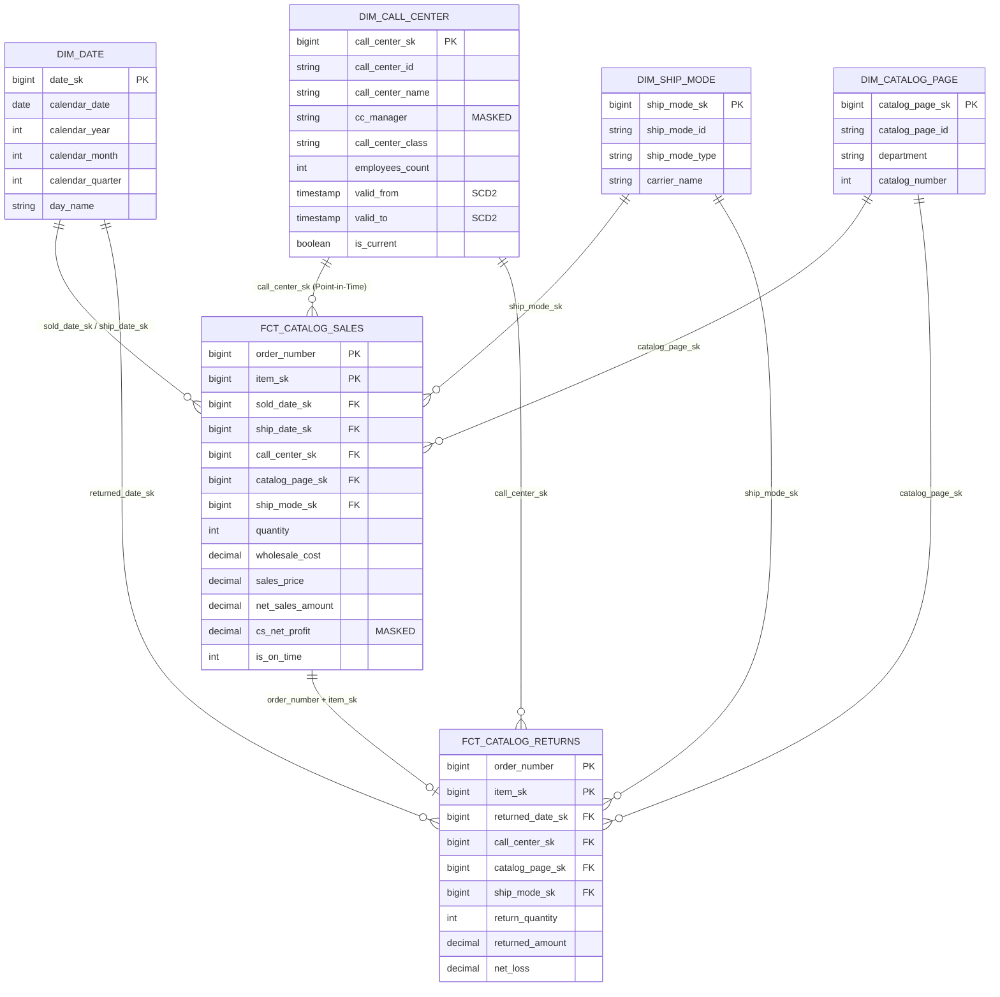

# Dimensional Model Architecture: Meridian Direct (Package 06)

## 1. Star Schema Overview

Meridian Direct models catalog sales orders and contact centre operations into an enterprise star schema in the Gold layer of Unity Catalog.



---

## 2. Declared Grains & Table Metadata

| Table Name | Layer | Declared Grain | Primary Key | Description |
|---|---|---|---|---|
| `gold.fct_catalog_sales` | Gold Fact | 1 row per order item line | `(order_number, item_sk)` | Records financial and logistical line-item fulfillment for all completed catalog orders. |
| `gold.fct_catalog_returns` | Gold Fact | 1 row per returned item line | `(order_number, item_sk)` | Records return reasons, restock logistics, and refunded financial amounts. |
| `gold.dim_call_center` | Gold Dimension | 1 row per call centre version window | `call_center_sk` (version surrogate) | Slowly Changing Dimension Type 2 tracking organizational changes (promotions, square footage, tier). |
| `gold.dim_date` | Gold Dimension | 1 row per calendar day | `date_sk` | Conformed date dimension providing calendar hierarchies (day, month, quarter, year). |
| `gold.dim_ship_mode` | Gold Dimension | 1 row per shipping mode code | `ship_mode_sk` | Logistics carrier and contract terms defining expected SLA delivery intervals. |
| `gold.dim_catalog_page` | Gold Dimension | 1 row per catalog page | `catalog_page_sk` | Marketing catalog layouts, page numbers, and print department references. |

---

## 3. SCD Type 2 Point-in-Time Join Logic

In classical dimensional modeling, joining a transactional fact to a dimension version must reflect the state of the entity **at the time of the sale**, rather than defaulting to the current version.

In our pipeline:
1. `fct_catalog_sales` contains transaction date `sale_date` (derived from `sold_date_sk`).
2. `dim_call_center` contains valid interval timestamps `valid_from` (`__START_AT`) and `valid_to` (`__END_AT`).
3. Point-in-time join condition:
   ```sql
   SELECT 
       s.order_number,
       s.item_sk,
       s.net_sales_amount,
       cc.call_center_name,
       cc.cc_manager,
       cc.call_center_class
   FROM gold.fct_catalog_sales s
   JOIN gold.dim_call_center cc
     ON s.call_center_sk = cc.call_center_sk
    AND s.sale_date >= CAST(cc.valid_from AS DATE)
    AND s.sale_date < COALESCE(CAST(cc.valid_to AS DATE), DATE '9999-12-31');
   ```
This ensures that historical financial reporting accurately attributes sales to the call centre manager and structure in effect on the order date.
